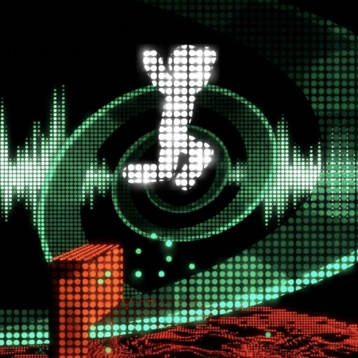

# Walk Cycle

An endless runner in the style of a pedestrian signal. Run up a spiral above a rising sea, jump the low barriers, duck under the hanging signs. Three hits and you're out.

## Files (all in one folder, no subfolders)
- `index.html` — the whole game.
- `*.mp3` — the three music tracks and their "hit" mixes.
- `share.png` — the link-preview thumbnail (iMessage and other apps).
- `icon-512.png`, `icon-192.png`, `apple-touch-icon.png`, `favicon-32.png`, `manifest.webmanifest` — the app icon for the browser tab and for a phone's home screen.

## Publish with GitHub Pages
1. Create a repository named `Walk-Cycle` and upload every file in this folder to its root.
2. In the repository, go to Settings → Pages, choose "Deploy from a branch", pick `main` and `/ (root)`, and save.
3. The game is then live at `https://imatination.github.io/Walk-Cycle/`.

The link preview uses full addresses. If the repository has a different name, edit the `og:url`, `og:image` and `twitter:image` lines near the top of `index.html` to match.

## Play locally
Browsers won't load the music when `index.html` is opened straight from disk (the game still runs, with a simple synth beat). To hear the tracks, run `python3 -m http.server` in this folder and open http://localhost:8000.

## Controls
- Touch: top half = jump, bottom half = duck — or tap SWAP CONTROLS for right side = jump, left side = duck.
- Keyboard: Up / Space / Right = jump, Down / Left = duck, M = mute, N = skip track.
